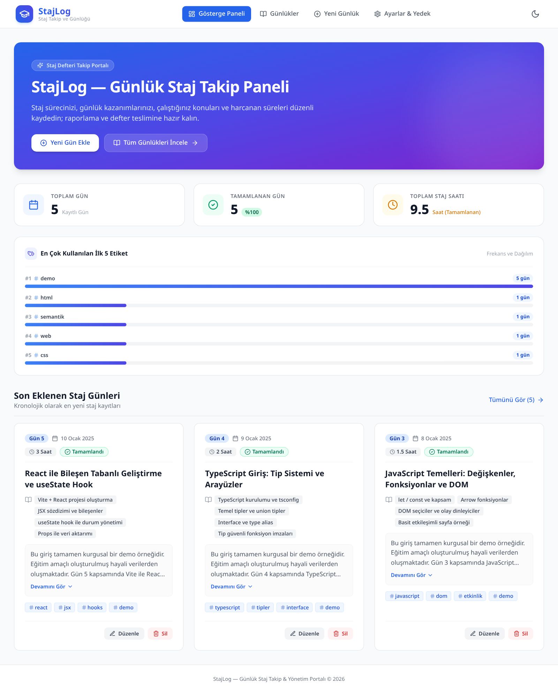
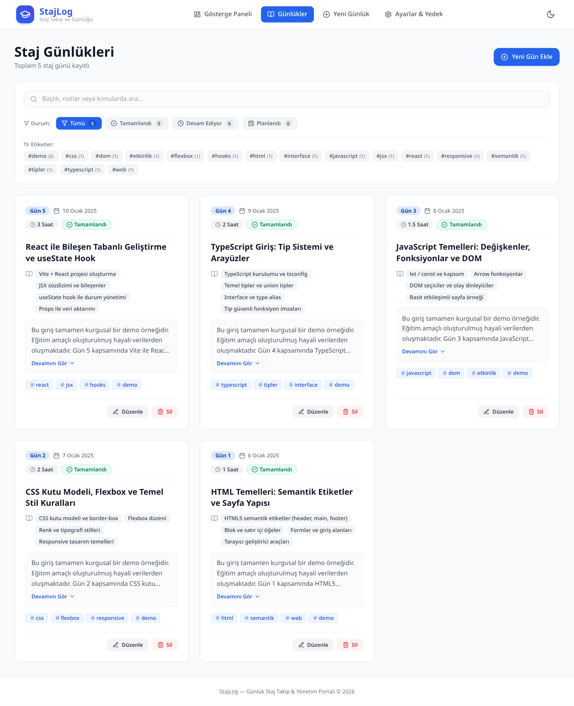
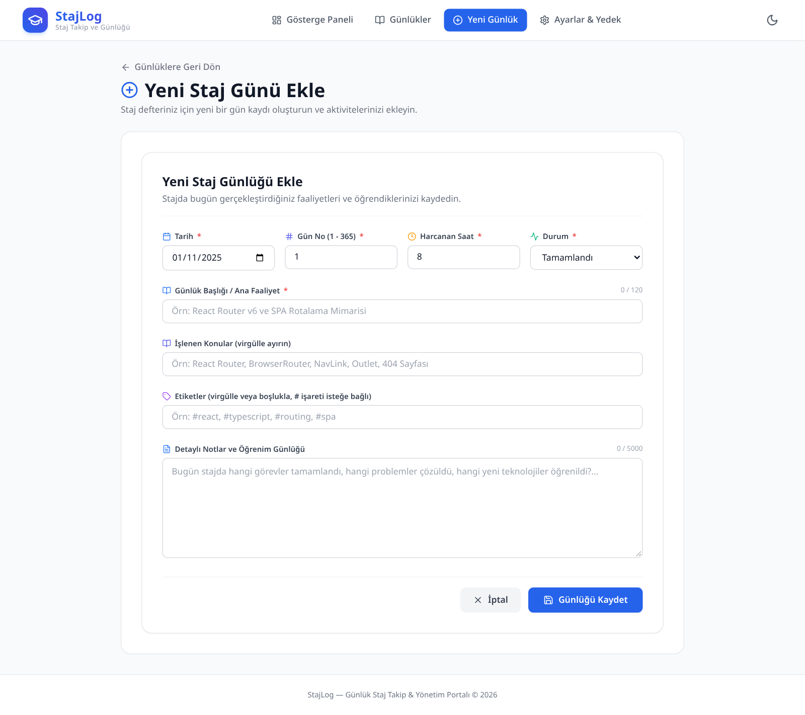
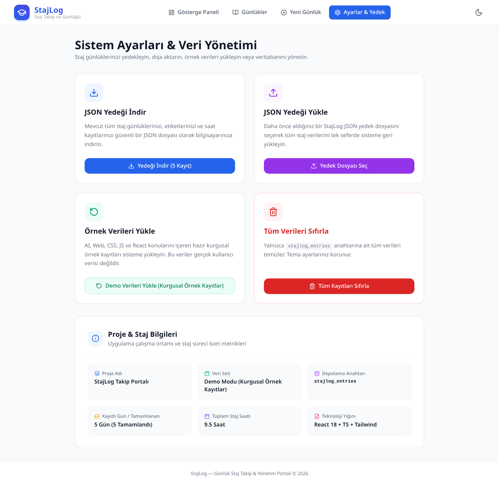

# 🚀 StajLog - Geliştirici ve Öğrenim Takip Günlüğü


---

## 📌 Proje Tanıtımı ve Amacı

**StajLog**, yazılımcıların, stajyerlerin ve öğrencilerin günlük çalışma saatlerini, üzerinde çalıştıkları teknik konuları, edindikleri kazanımları ve teknoloji etiketlerini düzenli bir biçimde kayıt altına almalarını sağlayan modern bir **Öğrenim ve Çalışma Günlüğü** tek sayfa web uygulamasıdır (SPA).

Kullanıcıların geçmiş günleri anlık filtreleme ve debounced arama ile incelemelerini, çalışma istatistiklerini takip etmelerini, verilerini JSON formatında güvenle yedekleyip geri yükleyebilmelerini sağlar.
---

## ✨ Temel Özellikler

1. **Eksiksiz CRUD Döngüsü:**
   - Yeni günlük çalışma kaydı oluşturma, listeleme, güncelleme ve silme.
   - İki adımlı silme onayı (`ConfirmModal`).
2. **Dashboard ve İstatistik Göstergeleri:**
   - Toplam tamamlanan çalışma günü ve saat sayaçları.
   - En çok çalışılan ilk 5 teknoloji etiketi ve dağılım grafiği.
   - Son eklenen 3 çalışma günü hızlı özet kartı.
3. **Akıllı Arama ve Filtreleme:**
   - 250ms debounced arama kutusu (başlık, konu ve notlarda anlık arama).
   - Çoklu etiket seçimi ve AND mantığıyla filtreleme.
4. **Kural Tabanlı Etiket Önerici:**
   - Form alanlarına girilen başlık ve notları tarar; tespit ettiği teknolojileri (React, TypeScript, Tailwind, Vite, API vb.) tıklanabilir çip olarak önerir.
5. **JSON Yedekleme ve Geri Yükleme (Data Portability):**
   - Tek tıkla tüm günlük verilerini versiyonlu JSON formatında indirme (`ExportPayload`).
   - JSON dosyasından şema kontrollü geri yükleme (`Import`).
   - Tekil `stajlog_entries` anahtarını sıfırlama veya kurgusal örnek kayıtları (gerçek kullanıcı verisi değildir) yeniden yükleme.
6. **Defensive Storage (Dayanıklı Yerel Depolama):**
   - Tarayıcı `localStorage` arızalarında, bozuk JSON içeriklerinde veya `QuotaExceededError` durumlarında çökmez; kullanıcıya bilgilendirici toast uyarısı sunar.
7. **Dark / Light Mod Desteği:**
   - Kullanıcının tercih ettiği temayı hatırlar ve tüm arayüzü Tailwind dark sınıflarıyla uyarlar.

---

## 🏗️ Mimari ve Klasör Hiyerarşisi

```text
stajlog/
├── public/
│   ├── _redirects                  # Netlify SPA rewrite kuralı (/* /index.html 200)
│   ├── favicon.svg                 # Uygulama logosu
│   └── icons.svg
├── screenshots/
│   ├── dashboard.png               # Yönetim paneli ekran görüntüsü
│   ├── entries.png                 # Günlükler listesi ekran görüntüsü
│   ├── entry-form.png              # Yeni kayıt formu ekran görüntüsü
│   └── settings.png                # Veri yönetimi ve ayarlar ekran görüntüsü
├── src/
│   ├── interfaces/
│   │   └── entry.ts                # Entry, EntryFormData, ExportPayload tip tanımları
│   ├── context/
│   │   └── EntryContext.tsx        # Global state yönetimi ve CRUD sağlayıcısı
│   ├── hooks/
│   │   ├── useLocalStorage.ts      # Hata toleranslı LocalStorage özel kancası
│   │   └── useDebounce.ts          # 250ms arama geciktirme kancası
│   ├── utils/
│   │   ├── validation.ts           # isEntry tip koruması, form doğrulama, normalizasyon
│   │   ├── tagSuggester.ts         # Kural tabanlı regex etiket önerici
│   │   └── initialData.ts          # Kurgusal başlangıç demo kayıtları (gerçek kullanıcı verisi değildir)
│   ├── components/
│   │   ├── Navbar.tsx              # Üst menü, rotalar ve Dark/Light buton
│   │   ├── EntryCard.tsx           # Tekil günlük kartı ve aksiyon butonları
│   │   ├── EntryForm.tsx           # Ekleme / düzenleme ortak formu
│   │   ├── ConfirmModal.tsx        # Erişilebilir onay penceresi
│   │   ├── StatsGrid.tsx           # Sayaç ve etiket istatistikleri
│   │   ├── TagSuggestions.tsx      # Tıklanabilir etiket öneri çipleri
│   │   └── index.ts
│   ├── pages/
│   │   ├── DashboardPage.tsx       # Özet gösterge paneli
│   │   ├── EntriesPage.tsx         # Listeleme, arama ve filtreleme sayfası
│   │   ├── EntryFormPage.tsx       # Dinamik Create/Edit form sayfası
│   │   ├── SettingsPage.tsx        # JSON yedekleme, geri yükleme ve sıfırlama
│   │   ├── NotFoundPage.tsx        # 404 Sayfası
│   │   └── index.ts
│   ├── App.tsx                     # BrowserRouter ve rota tanımları
│   ├── main.tsx                    # React kök montaj noktası
│   └── index.css                   # Tailwind v3 direktifleri
├── index.html                      # HTML5 kabuğu
├── package.json                    # Bağımlılıklar ve derleme betikleri
├── postcss.config.js               # PostCSS yapılandırması
├── tailwind.config.js              # Tailwind v3 içerik ve tema ayarları
├── tsconfig.json                   # TypeScript kök konfigürasyonu
├── tsconfig.app.json
├── tsconfig.node.json
└── vite.config.ts                  # Vite derleme yapılandırması
```

---

## 📸 Ekran Görüntüleri

### Gösterge Paneli (Dashboard)


### Günlükler Listesi, Arama ve Filtreleme (Entries)


### Yeni Kayıt Oluşturma & Kural Tabanlı Etiket Önerisi (Entry Form)


### Veri Yönetimi & JSON Yedekleme / Yükleme (Settings)


---

## 🛠️ Yerel Kurulum ve Çalıştırma Rehberi

Projeyi yerel makinenizde çalıştırmak için aşağıdaki adımları takip ediniz:

### Gereksinimler
- Node.js (>= 20.0.0, test edilen: v24.18.0)
- npm (>= 9.0.0)

### 1. Depoyu Klonlayın ve Bağımlılıkları Yükleyin
```bash
git clone https://github.com/furkan-uzmez/StajLog.git
cd StajLog
npm ci
```

### 2. Geliştirme Sunucusunu Başlatın
```bash
npm run dev
```
Tarayıcınızda `http://localhost:5173` adresine giderek uygulamayı görüntüleyin.

### 3. Üretim Derlemesi Alın (Production Build)
```bash
npm run build
```
TypeScript tip kontrolü (`tsc -b`) ve Vite optimizasyonu yapılarak `dist/` klasörü üretilir.

### 4. Üretim Önizlemesini Çalıştırın
```bash
npm run preview
```
`http://localhost:4173` adresinde derlenmiş paket önizlenir.

---

## 🌐 Netlify Dağıtım Rehberi

Uygulama Netlify üzerinde sıfır sunucu maliyetiyle statik SPA olarak dağıtılmaya hazır olarak tasarlanmıştır.

### Netlify Yapılandırma Bilgileri:
* **Base directory:** Boş bırakın (uygulama depo kökünde).
* **Build command:** `npm run build`
* **Publish directory:** `dist`

Depodaki `netlify.toml`, build komutunu, `dist` yayın dizinini ve Node.js 24
sürümünü tanımlar. GitHub deposunu bağlayarak build çalıştırın; kaynak klasörü
yerine yalnızca derlenmiş `dist/` çıktısını yayınlayın. Manuel yüklemede de
önce `npm run build` çalıştırıp yalnızca `dist/` klasörünü yükleyin.

### SPA Alt Rota Desteği (`_redirects`):
React Router v6 ile istemci tarafı rotalamanın (örn. `/entries`, `/settings`) tarayıcı yenilemelerinde (F5) 404 vermemesi için `public/_redirects` dosyası mevcuttur:
```text
/*    /index.html   200
```
Bu kural Netlify tarafından derleme çıktısı olan `dist/_redirects` altına otomatik kopyalanır ve tüm alt yolları `index.html`'e yönlendirir.

---

## 📦 Proje Bilgileri

* **Teknoloji Yığını:** React 18, TypeScript, Tailwind CSS, Vite
* **Lisans:** MIT
